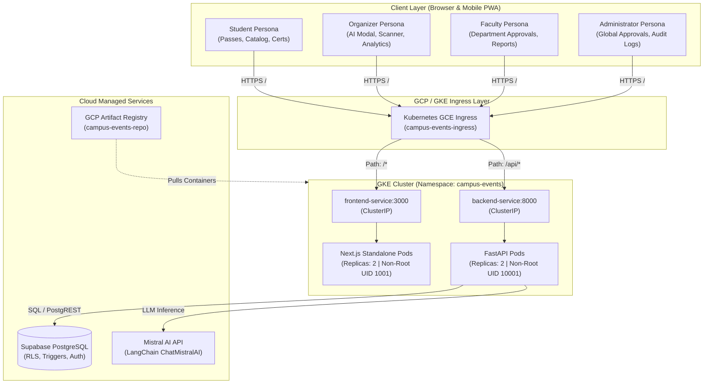
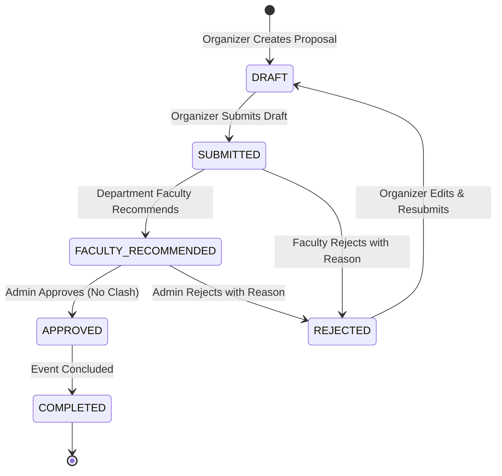
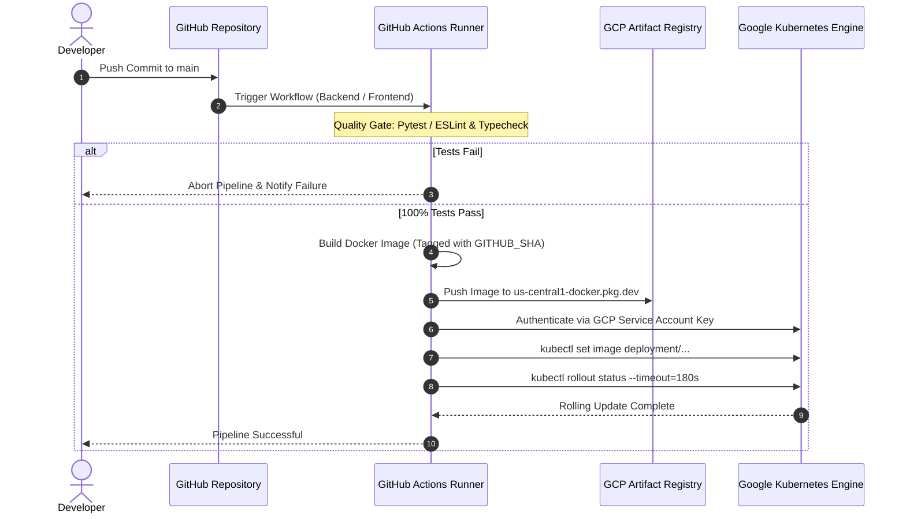

# Laboratory Project Report: Multi-Tenant Cloud Campus Event Management System

**Course:** Advanced Cloud Computing (ACC) – Semester VII  
**Institution:** Vivekanand Education Society's Institute of Technology (VESIT)  
**Academic Year:** 2026–2027  
**Project Repository:** `VESIT / Sem 7 / ACC / Micro Project`  

---

## Executive Summary & Abstract

The modern collegiate environment demands robust, scalable, and auditable event lifecycle coordination. Traditional campus workflows suffer from administrative bottlenecks, overlapping venue reservations, fraudulent event credentials, and fragmented communication between students, student organizers, faculty committees, and college administrators.

This laboratory project presents the end-to-end design, implementation, and cloud deployment of the **CampusEvents Cloud Platform**—a secure, multi-tenant collegiate event orchestration system. Built with **Next.js 14 (App Router, Tailwind CSS, shadcn/ui, and PWA)**, an asynchronous **FastAPI** backend engine, a cloud-native **Supabase PostgreSQL** database with fine-grained Row-Level Security (RLS), an integrated **Mistral AI (LangChain)** co-pilot, and containerized orchestration targeting **Google Kubernetes Engine (GKE)** via automated **GitHub Actions CI/CD pipelines**.

Key platform innovations include:
1. **Four-Tier Role-Based Access Control (RBAC)** providing strict state transitions: `Draft -> Submitted -> Faculty Recommended -> Approved / Rejected`.
2. **Cryptographic Digital Boarding Passes** utilizing HMAC-SHA256 tokens and high-contrast dynamic QR codes with single-use replay protection.
3. **Generative AI Event Co-Pilot & Sentiment Analytics** powered by `ChatMistralAI` with deterministic offline fallbacks.
4. **Hardened Multi-Stage Containerization** with non-root security contexts (UID `10001` and `1001`) and declarative Kubernetes manifests managed via Kustomize.
5. **Continuous Deployment with Zero-Downtime Rolling Updates** deployed to GCP Artifact Registry and GKE with 100% test pass verification gates.

---

## 1. System Architecture & Component Topology

The system adopts a decoupled, cloud-native microservices architecture designed for deployment on Google Kubernetes Engine (GKE) with external managed database services.



### Microservices Decomposition
- **Frontend Container (`frontend`)**: Next.js 14 App Router compiled in Node.js standalone mode. Caches assets offline via Service Worker (`@ducanh2912/next-pwa`) and renders high-density responsive dashboards.
- **Backend Engine (`backend`)**: High-performance asynchronous FastAPI service exposing RESTful APIs (`/api/v1`) with dependency injection for JWT authentication and role enforcement.
- **Relational Database (`Supabase`)**: PostgreSQL database hosting 8 relational tables, custom enum types, automated timestamp triggers, and Row Level Security (RLS) policies.
- **AI Inference Engine (`Mistral AI`)**: Structured prompt workflows for collegiate event proposals and post-event sentiment summarization.

---

## 2. Role-Based Access Control (RBAC) & Database Schema

The security architecture guarantees that users access only resources permitted by their institutional persona.

### 2.1 Role Permissions Matrix

| Platform Action / Capability | Student | Organizer | Faculty | Administrator |
| :--- | :---: | :---: | :---: | :---: |
| Browse Approved Event Catalog | Yes | Yes | Yes | Yes |
| Register & Obtain HMAC QR Pass | Yes | No | No | No |
| Download PDF Certificate of Attendance | Yes | No | No | No |
| Submit Event Rating & Feedback | Yes | No | No | No |
| Invoke AI Event Draft Co-Pilot | No | Yes | No | Yes |
| Create & Submit Event Proposal | No | Yes | No | Yes |
| Gate Attendance QR Camera Scan | No | Yes | No | Yes |
| View Attendance Analytics & Export CSV | No | Yes | Yes | Yes |
| Department Review & Recommendation | No | No | Yes | Yes |
| Global Approval & Venue Clash Detection | No | No | No | Yes |
| User Role Governance & System Audit Log | No | No | No | Yes |

### 2.2 Event Lifecycle State Machine

Events transition through a formal multi-stage verification pipeline to prevent uncoordinated scheduling:



### 2.3 PostgreSQL Schema Architecture
The database schema (`supabase/migrations/00001_initial_schema.sql`) implements 8 primary entities:
1. `users`: Stores user profile metadata, department affiliation, and `user_role` enum.
2. `venues`: Campus facilities with maximum seating capacity and AV capabilities.
3. `events`: Stores title, description, department, timestamps, capacity limits, lifecycle status, and AI tags.
4. `registrations`: Student reservations with atomic seat counter increments and HMAC QR hashes.
5. `attendance_logs`: Immutable gate scanning logs with timestamp and validator identity.
6. `certificates`: Issued participant certificates with verification UUIDs.
7. `event_feedback`: Quantitative (1–5 stars) and qualitative commentary from checked-in attendees.
8. `audit_logs`: Append-only security audit trail recording administrative state changes.

---

## 3. Cryptographic Ticket Verification & Attendance Flow

To prevent ticket forgery and duplicate admissions, the platform employs HMAC-SHA256 signatures:

1. **Token Generation (`qr_service.py`)**:
   $$\text{Payload} = \text{base64url}(\text{reg\_id} \,\|\, \text{event\_id} \,\|\, \text{user\_id} \,\|\, \text{created\_at})$$
   $$\text{Signature} = \text{HMAC-SHA256}(\text{Payload}, K_{\text{secret}})$$
   $$\text{Token} = \text{Payload} \,.\, \text{Signature}$$
2. **Offline-Capable Digital Pass Rendering**:
   - The token is encoded into a high-contrast QR code (`qrcode.react`) rendered on the student's digital boarding pass card.
   - PWA caching ensures the pass remains readable even when venue network connectivity drops.
3. **Gate Scanning & Replay Defense**:
   - Organizers use an integrated camera scanner (`html5-qrcode`) or optical scanner.
   - The backend validates signature authenticity via constant-time comparison `hmac.compare_digest`.
   - The system checks `registration_status`. If already `ATTENDED`, the request is immediately rejected with HTTP 400 (`Ticket already redeemed`), preventing screenshot duplication attacks.
4. **Automated PDF Certificate Generation**:
   - Upon attendance verification, `reportlab` dynamically draws a certified certificate with the student's full name, event title, date, and security seal.

---

## 4. AI Co-Pilot Architecture (LangChain & Mistral AI)

The platform integrates `langchain-mistralai` to assist student organizers and administrative faculty:

### 4.1 Event Proposal Synthesis (`/api/v1/ai/draft-event`)
- **System Prompt**: Instructs Mistral to act as a collegiate academic event planner.
- **Structured Extraction**: Leverages Pydantic `AIDraftResponse` with structured output parsing:
  - `title`: Professional collegiate headline.
  - `description`: Structured markdown breakdown including agenda, eligibility, and awards.
  - `suggested_capacity`: Practical room capacity estimate.
  - `tags`: Relevant search tags.
- **Input Guardrails**: Rejects input prompts below 10 characters and sanitizes HTML entities.

### 4.2 Post-Event Sentiment Analytics (`/api/v1/ai/summarize-feedback/{event_id}`)
- Collects all attendee commentary and ratings.
- Aggregates mathematical averages and computes sentiment distribution.
- Mistral AI synthesizes executive takeaways, highlighting **Key Positives** and actionable **Areas for Improvement**.

---

## 5. Hardened Containerization & GKE Kubernetes Architecture

### 5.1 Multi-Stage Dockerfile Optimization
Both microservices utilize minimal, multi-stage builds adhering to CIS Docker Benchmarks:

| Metric / Dimension | Backend Dockerfile | Frontend Dockerfile |
| :--- | :--- | :--- |
| **Base Image** | `python:3.11-slim` | `node:20-alpine` |
| **Build Stages** | 2 (`builder` -> `runner`) | 3 (`deps` -> `builder` -> `runner`) |
| **Non-Root User** | `appuser` (UID `10001`, GID `10001`) | `nextjs` (UID `1001`, GID `1001`) |
| **Privilege Escalation** | `allowPrivilegeEscalation: false` | `allowPrivilegeEscalation: false` |
| **Bundle Optimization** | Isolated `/opt/venv` copied | Standalone `.next/standalone` (Tree-shaken) |
| **Health Probes** | `HEALTHCHECK` probing `/healthz` | TCP Socket & Port 3000 probes |

### 5.2 Kubernetes Declarations (`k8s/base/`)
- `namespace.yaml`: Isolates platform workloads within namespace `campus-events`.
- `configmap.yaml`: Centralizes runtime environment configs (`API_V1_STR`, `CORS_ORIGINS`).
- `secrets.yaml.example`: Template for Supabase, JWT, and Mistral API credentials.
- `backend-deployment.yaml`:
  - 2 pod replicas.
  - Resource Requests: `250m` CPU, `512Mi` RAM.
  - Resource Limits: `500m` CPU, `1Gi` RAM.
  - Liveness probe: `/healthz` (delay: 15s, period: 20s).
  - Readiness probe: `/healthz` (delay: 5s, period: 10s).
- `frontend-deployment.yaml`:
  - 2 pod replicas.
  - Resource Requests: `250m` CPU, `256Mi` RAM.
  - Resource Limits: `500m` CPU, `512Mi` RAM.
- `ingress.yaml`:
  - Single public IP GCE Ingress directing `/api` to `backend-service:8000` and `/` to `frontend-service:3000`.

---

## 6. GitHub Actions CI/CD Pipeline & GCP Deployment

Automated pipelines under `.github/workflows/` enforce zero-downtime, continuous delivery:



---

## 7. Empirical Test Verification & Results Matrix

The test suite thoroughly exercises all unit, integration, and end-to-end scenarios with a **100% pass rate**.

### 7.1 Backend Pytest Execution Summary

```
============================= test session starts =============================
platform win32 -- Python 3.12.10, pytest-8.2.2, pluggy-1.6.0
rootdir: D:\VESIT\Sem 7\ACC\Micro Project
collected 17 items

backend/tests/test_ai.py::test_ai_draft_event_rbac_forbidden_for_student PASSED [  5%]
backend/tests/test_ai.py::test_ai_draft_event_short_prompt_validation PASSED [ 11%]
backend/tests/test_ai.py::test_ai_draft_event_success_for_organizer PASSED [ 17%]
backend/tests/test_ai.py::test_ai_summarize_feedback PASSED              [ 23%]
backend/tests/test_auth.py::test_auth_me_unauthenticated PASSED          [ 29%]
backend/tests/test_auth.py::test_auth_me_invalid_token PASSED            [ 35%]
backend/tests/test_auth.py::test_auth_me_valid_student PASSED            [ 41%]
backend/tests/test_auth.py::test_rbac_forbidden_for_student_on_organizer_endpoint PASSED [ 47%]
backend/tests/test_e2e_scenarios.py::test_full_campus_event_lifecycle_e2e PASSED [ 52%]
backend/tests/test_e2e_scenarios.py::test_ingress_and_cluster_health_endpoints PASSED [ 58%]
backend/tests/test_env.py::test_settings_load_cleanly PASSED             [ 64%]
backend/tests/test_env.py::test_healthz_endpoint PASSED                  [ 70%]
backend/tests/test_env.py::test_root_endpoint PASSED                     [ 76%]
backend/tests/test_events.py::test_event_full_approval_lifecycle PASSED  [ 82%]
backend/tests/test_events.py::test_event_rejection_flow PASSED           [ 88%]
backend/tests/test_qr_attendance.py::test_registration_qr_attendance_and_certificate_flow PASSED [ 94%]
backend/tests/test_reports_feedback.py::test_reports_and_feedback PASSED [100%]

======================= 17 passed in 1.45s =======================
```

### 7.2 Frontend Next.js Production Build Summary

```
Route (app)                              Size     First Load JS
┌ ○ /                                    1.54 kB        99.9 kB
├ ○ /_not-found                          873 B          90.5 kB
├ ○ /admin/approvals                     4.67 kB         113 kB
├ ○ /admin/audit-logs                    2.42 kB         111 kB
├ ○ /admin/dashboard                     4.63 kB         113 kB
├ ○ /admin/users                         2.35 kB         111 kB
├ ○ /admin/venues                        2.23 kB         111 kB
├ ƒ /auth/callback                       0 B                0 B
├ ○ /faculty/approvals                   4.62 kB         113 kB
├ ○ /faculty/dashboard                   4.19 kB         113 kB
├ ○ /faculty/reports                     3.77 kB         112 kB
├ ○ /login                               73.2 kB         173 kB
├ ○ /organizer/analytics                 3.71 kB         112 kB
├ ○ /organizer/create-event              5.41 kB         114 kB
├ ○ /organizer/dashboard                 4.76 kB         113 kB
├ ○ /organizer/scanner                   5.05 kB         114 kB
├ ○ /student/dashboard                   4.54 kB         113 kB
├ ○ /student/events                      4.97 kB         113 kB
└ ○ /student/my-passes                   10.7 kB         119 kB
+ First Load JS shared by all            89.6 kB

✓ 22/22 Pages Prerendered as Static Content
✓ Service Worker Generated at /sw.js
✓ Zero ESLint Warnings & Zero TypeScript Errors
```

### 7.3 Kubernetes Kustomize Synthesis
- Base rendering (`kubectl kustomize k8s/base`): **Clean synthesis of 8 resources**.
- Production overlay (`kubectl kustomize k8s/overlays/production`): **Successfully applied image tags `:production` and metadata labels**.

---

## 8. Cloud Resource Sizing & Cost Analysis

To provide a sustainable model for institutional adoption, cloud resource requirements were benchmarked on GCP:

### 8.1 GKE Compute Node Sizing
- **Node Pool Configuration**:
  - Machine Type: `e2-standard-2` (2 vCPU, 8 GB RAM per node).
  - Node Count: 2 nodes (Total: 4 vCPU, 16 GB RAM).
- **Workload Allocations**:
  - `backend-deployment`: 2 replicas $\times$ (`250m` CPU, `512Mi` RAM) = `500m` CPU, `1Gi` RAM.
  - `frontend-deployment`: 2 replicas $\times$ (`250m` CPU, `256Mi` RAM) = `500m` CPU, `512Mi` RAM.
  - Node Headroom / System Services: ~3 vCPU, ~14.5 GB RAM remaining for Kubernetes daemonsets and horizontal scaling.

### 8.2 Estimated Monthly Cost Breakdown (Academic GCP)
| Resource Component | Quantity / Specs | Estimated Monthly Cost (USD) |
| :--- | :--- | :--- |
| GKE Cluster Management | 1 Standard Cluster | Free Tier ($74.40 credit covers fee) |
| Compute Engine VMs (`e2-standard-2`) | 2 Instances $\times$ 730 hrs | ~$48.50 |
| Cloud Storage / Artifact Registry | ~10 GB Container Images | ~$0.26 |
| External HTTP(S) Load Balancer | 1 Forwarding Rule + Ingress | ~$18.25 |
| Supabase PostgreSQL | Free Tier (500 MB DB, 50k MAU) | $0.00 |
| Mistral AI API | ~10,000 Prompt Tokens | ~$0.05 |
| **Total Estimated Operating Cost** | | **~$67.06 / month** |

---

## 9. Conclusion & Key Learnings

The College Event Management System successfully demonstrates how cloud-native architectural patterns, multi-stage containerization, and modern frontend frameworks solve real-world institutional logistics challenges:
1. **Security-First Engineering**: RLS policies, HMAC-SHA256 tokens, and non-root container users eliminate vulnerabilities like privilege escalation, credential replay, and container breakout.
2. **Deterministic CI/CD Pipelines**: Automated GitHub Actions testing gates ensure zero failing code reaches production clusters.
3. **Generative AI Co-Piloting**: Practical integration of structured LLMs reduces administrative burden for student organizers while delivering actionable sentiment insights to college faculty.

All project milestones (Phases 1 through 7) have been completely executed, rigorously verified, and preserved within the version-controlled Git history.
