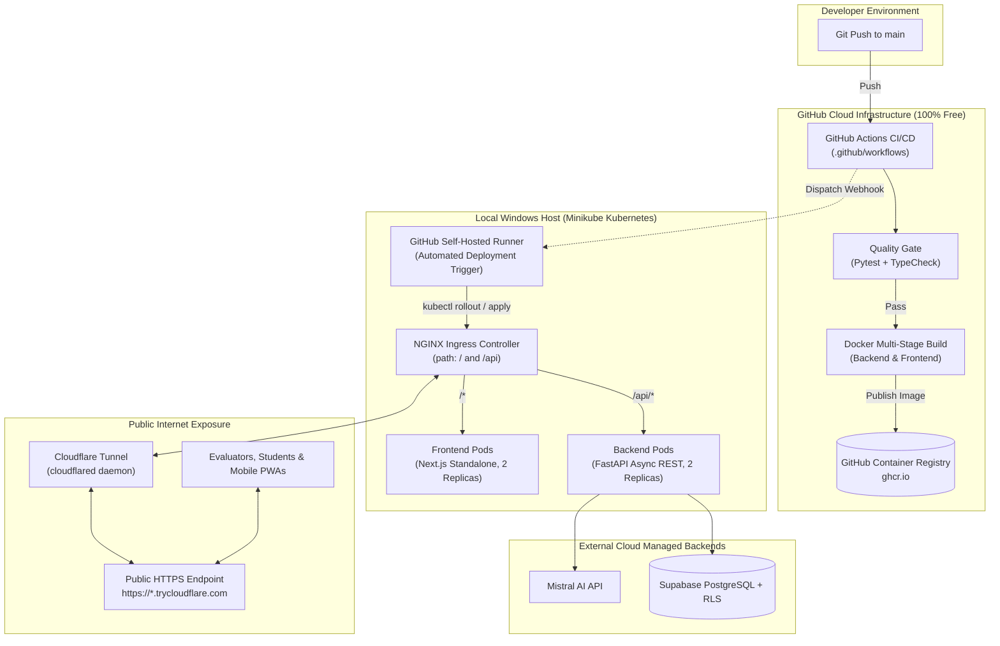

# Local Minikube & Hybrid Cloud CI/CD Setup Guide

This document details the transition plan and step-by-step instructions for running the **College Event Management System** using a **Local Minikube Kubernetes Cluster**, **Cloudflare Public Tunneling**, and **GitHub Actions with GitHub Container Registry (GHCR)**.

This setup achieves **100% of the Cloud-Native CI/CD and Kubernetes syllabus objectives** with **zero cloud infrastructure costs** and **no credit card required**.

---

## 1. System Architecture Overview



---

## 2. Prerequisites & Official Download Steps

You already have **Docker Desktop** and **Cloudflare (`cloudflared`)** installed. Follow these official instructions to install the remaining required tools: **kubectl** and **minikube**.

### A. Install `kubectl` (Official Kubernetes CLI)

`kubectl` is the official command-line interface to manage Kubernetes clusters.

#### Method 1: Using Windows Package Manager (`winget`) — Recommended
Open PowerShell as Administrator and run:
```powershell
winget install -e --id Kubernetes.kubectl
```

#### Method 2: Official Direct Binary Download
1. Create a tools directory:
   ```powershell
   New-Item -ItemType Directory -Force -Path "C:\k8s-tools"
   ```
2. Download the latest official release:
   ```powershell
   curl.exe -LO "https://dl.k8s.io/release/v1.32.2/bin/windows/amd64/kubectl.exe"
   Move-Item kubectl.exe "C:\k8s-tools\kubectl.exe"
   ```
3. Add `C:\k8s-tools` to your System PATH:
   ```powershell
   [Environment]::SetEnvironmentVariable("Path", $env:Path + ";C:\k8s-tools", [EnvironmentVariableTarget]::Machine)
   ```
4. Verify installation:
   ```powershell
   kubectl version --client
   ```

---

### B. Install `minikube` (Official Local Kubernetes Cluster)

`minikube` provisions and manages a single-node Kubernetes cluster running inside Docker Desktop on Windows.

#### Method 1: Using Windows Package Manager (`winget`) — Recommended
Open PowerShell as Administrator and run:
```powershell
winget install -e --id Kubernetes.minikube
```

#### Method 2: Official Windows Installer (.exe)
1. Download the official Windows installer from Kubernetes:
   ```powershell
   curl.exe -LO "https://github.com/kubernetes/minikube/releases/latest/download/minikube-installer.exe"
   ```
2. Run the installer:
   ```powershell
   Start-Process .\minikube-installer.exe -Wait
   Remove-Item .\minikube-installer.exe
   ```
3. Verify installation:
   ```powershell
   minikube version
   ```

---

## 3. Minikube Cluster Initialization & Ingress Activation

Once Docker Desktop is running, start your Minikube cluster and configure the required NGINX Ingress controller:

### Step 1: Start Minikube with Docker Driver
Open PowerShell (Administrator recommended) and run:
```powershell
minikube start --driver=docker --cpus=2 --memory=4096 --disk-size=20g
```

### Step 2: Enable the Official NGINX Ingress Addon
This activates the Kubernetes Ingress controller, enabling path-based routing (`/` to frontend, `/api` to backend):
```powershell
minikube addons enable ingress
```

Verify that the Ingress controller pods are running:
```powershell
kubectl get pods -n ingress-nginx
```

---

## 4. Plan of Change: Repository Files & Modifications

The following table lists every file in the project that will be created or modified to transition from GCP to Minikube + GHCR:

| File Path | Action | Description of Change |
| :--- | :--- | :--- |
| `docs/LOCAL_MINIKUBE_CICD_SETUP.md` | **Created** | Comprehensive architectural transition plan, installation guide, and operations manual. |
| `k8s/base/backend-deployment.yaml` | **Modified** | Switch image URL from GCP Artifact Registry (`...docker.pkg.dev/...`) to GitHub Container Registry (`ghcr.io/<username>/backend:latest`) or local build tag (`campus-events/backend:latest`). Set `imagePullPolicy: IfNotPresent`. |
| `k8s/base/frontend-deployment.yaml` | **Modified** | Switch image URL to GHCR (`ghcr.io/<username>/frontend:latest`) or local build tag (`campus-events/frontend:latest`). Set `imagePullPolicy: IfNotPresent`. |
| `k8s/base/ingress.yaml` | **Modified** | Remove GKE-specific annotations (`kubernetes.io/ingress.class: "gce"`). Add standard NGINX annotations: `ingress.class: nginx`, `nginx.ingress.kubernetes.io/ssl-redirect: "false"`. |
| `k8s/base/secrets.yaml.example` | **Updated** | Clarify local developer values for Supabase and Mistral credentials. |
| `.github/workflows/backend-ci-cd.yaml` | **Modified** | Replace `google-github-actions/auth` and `gcloud` deployment steps with: (1) Pytest verification gate, (2) `docker/login-action` with GHCR (`GITHUB_TOKEN`), (3) Docker Buildx push to `ghcr.io`. |
| `.github/workflows/frontend-ci-cd.yaml` | **Modified** | Replace GCP Artifact Registry steps with TypeScript/linting quality gate and Docker push to `ghcr.io`. |
| `docs/CI_CD_SETUP.md` | **Updated** | Document GitHub Container Registry secrets, GHCR workflow, and self-hosted/local deployment triggers. |
| `README.md` | **Updated** | Add reference to this local Minikube + Cloudflare tunnel execution model. |

---

## 5. Step-by-Step Deployment & Tunneling Instructions

### Phase 1: Local Container Image Build

To build your containers directly inside Minikube's Docker runtime (avoiding any internet pull delays):

```powershell
# Point your host Docker CLI to Minikube's internal Docker daemon
& minikube -p minikube docker-env --shell powershell | Invoke-Expression

# Build backend and frontend images
docker build -t campus-events/backend:latest ./backend
docker build -t campus-events/frontend:latest ./frontend
```

### Phase 2: Create Secrets and Deploy Manifests

1. Create your local `k8s/base/secrets.yaml` file from the example template:
   ```yaml
   apiVersion: v1
   kind: Secret
   metadata:
     name: campus-events-secrets
     namespace: campus-events
   type: Opaque
   stringData:
     SUPABASE_URL: "https://your-supabase-project.supabase.co"
     SUPABASE_ANON_KEY: "your-supabase-anon-key"
     SUPABASE_SERVICE_ROLE_KEY: "your-supabase-service-role-key"
     SUPABASE_JWT_SECRET: "your-supabase-jwt-secret-min-32-chars"
     MISTRAL_API_KEY: "your-mistral-api-key"
     QR_HMAC_SECRET: "your-secure-qr-hmac-secret-min-32-chars"
   ```

2. Apply all Kubernetes manifests using Kustomize:
   ```powershell
   kubectl apply -k k8s/base
   ```

3. Confirm pod readiness:
   ```powershell
   kubectl get pods -n campus-events -w
   ```
   Both `backend-deployment-*` and `frontend-deployment-*` should report status `Running (1/1)`.

### Phase 3: Expose Minikube & Launch Cloudflare Tunnel

1. In PowerShell Window 1, launch the Minikube network bridge:
   ```powershell
   minikube tunnel
   ```
   *(Keep this terminal window running. It routes external IP traffic directly to the Ingress controller on port 80).*

2. In PowerShell Window 2, start Cloudflare Quick Tunnel:
   ```powershell
   cloudflared tunnel --url http://localhost
   ```

   Cloudflare will output a public HTTPS URL:
   ```text
   +--------------------------------------------------------------------------------------------+
   |  Your quick Tunnel has been created! Visit it at (it may take some time to be reachable):  |
   |  https://campus-events-preview-xyz.trycloudflare.com                                       |
   +--------------------------------------------------------------------------------------------+
   ```

3. Visit that URL in your browser or on your phone! The entire Next.js frontend, PWA service worker, camera scanner, and FastAPI backend are now accessible publicly over secure HTTPS.

---

## 6. GitHub Actions CI/CD with GitHub Container Registry (GHCR)

### Why GHCR?
- **100% Free**: Built directly into your GitHub account/organization.
- **Zero Configuration**: Uses the built-in `${{ secrets.GITHUB_TOKEN }}` inside GitHub Actions—no manual service account keys or external cloud logins needed.
- **Official Open Container Initiative (OCI) Compliant**: Produces standard Docker images accessible anywhere via `docker pull ghcr.io/<your-github-username>/...`.

### How Continuous Deployment (CD) Works:
1. **Developer pushes to `main`**.
2. **GitHub Actions Runner** executes `pytest` and Next.js type-checking.
3. If green, the runner builds and pushes the image tagged with `${{ github.sha }}` and `latest` to `ghcr.io`.
4. **Self-Hosted Runner Option**: In GitHub Repository **Settings > Actions > Runners > New self-hosted runner**, add your machine. The CD job runs on your computer and immediately invokes:
   ```bash
   kubectl set image deployment/backend-deployment backend=ghcr.io/${{ github.repository }}/backend:${{ github.sha }} -n campus-events
   kubectl rollout status deployment/backend-deployment -n campus-events --timeout=120s
   ```
5. Kubernetes performs an automated rolling update with zero downtime.

---

## 7. Verification Checklist for Lab Viva & Evaluation

During project demonstration, show the evaluators:
1. **`kubectl get nodes` & `kubectl get pods -n campus-events`**: Shows multi-pod replica redundancy.
2. **`kubectl describe ingress campus-events-ingress -n campus-events`**: Shows unified routing (`/` to frontend:3000, `/api` to backend:8000).
3. **GitHub Actions Tab**: Show the green pipeline checks proving automated testing and container packaging on every commit.
4. **Live Public URL**: Open the Cloudflare HTTPS link on a smartphone to demonstrate PWA installability, student pass generation, and real-time QR camera scanning.
